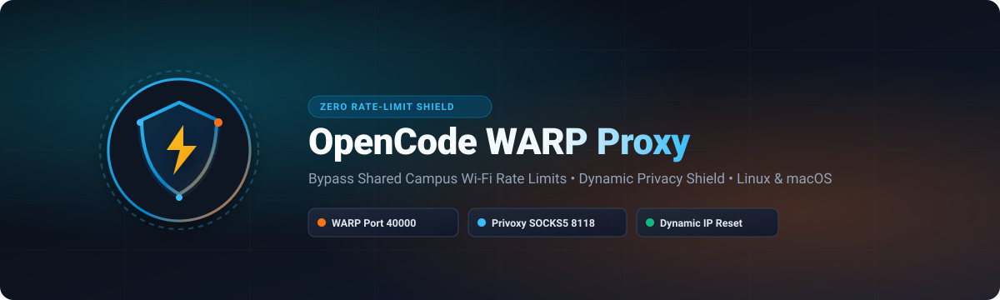
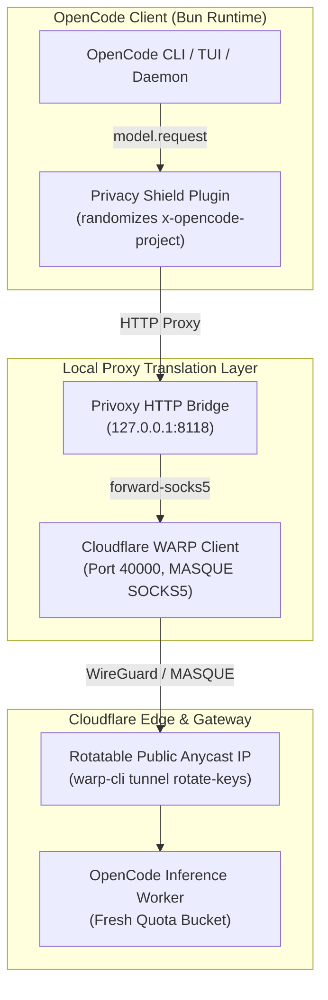

<p align="center">
  
</p>

<p align="center">
  <a href="https://github.com/pritkr/opencode-warp-proxy/releases"></a>
  <a href="LICENSE"></a>
  
  
  
  
</p>

<h3 align="center">
  A resilient, cross-platform proxy bridge and zero-correlation privacy shield for <a href="https://opencode.ai">OpenCode</a>.
</h3>

<p align="center">
  Eliminates shared campus Wi-Fi rate limits (<code>Free usage limit reached / Resets at 5:30 AM</code>) using <b>Cloudflare WARP</b> via a local <b>Privoxy</b> translation bridge, while dynamically randomizing project tracking identifiers on demand.
</p>

---

## ⚡ Quick Start (One-Liner)

Install and activate on **Linux** (CachyOS, Arch, Ubuntu, Debian, Fedora) or **macOS**:

```bash
curl -fsSL https://raw.githubusercontent.com/pritkr/opencode-warp-proxy/main/install.sh | bash
```

> [!TIP]
> This command auto-detects your OS, installs/configures Privoxy, deploys the `opencode-proxy` CLI to `~/.local/bin`, installs the privacy shield plugin, and performs an initial IP rotation & reset.

---

## 📋 Table of Contents

- [The Problem](#-the-problem)
- [How It Works](#-how-it-works)
- [Command Reference](#-command-reference)
- [The `reset` Command Explained](#-the-reset-command-explained)
- [Automatic Retry Runner](#-automatic-retry-runner-run)
- [Model Selection Gotcha](#-model-selection-gotcha)
- [Architecture & File Structure](#-architecture--file-structure)
- [Compatibility](#-compatibility)
- [License](#-license)

---

## 🚨 The Problem

1. **Shared IP Depletion:** On campus, dorm, or office Wi-Fi, hundreds of students share a single public NAT IPv4 address. OpenCode rate-limits free-tier models (such as `opencode/deepseek-v4.1-flash-free`) by public IP in Upstash Redis. When the shared IP runs out of hourly quota, everyone on that Wi-Fi gets blocked.
2. **Bun's SOCKS5 Incompatibility:** OpenCode runs on the Bun runtime. Bun's native `fetch()` does not support `socks5://` proxy schemes and throws `UnsupportedProxyProtocol`.
3. **Session Correlation:** OpenCode attaches persistent project identifiers (`x-opencode-project`) and directory paths across requests, preventing users from separating conversations or refreshing their rate-limit bucket.
4. **Anti-Bot Throttling:** Deleting headers entirely or setting `DO_NOT_TRACK: 1` triggers anti-bot scrutiny on the Cloudflare inference gateway, causing stricter rate limits.

---

## 🛠️ How It Works



1. **WARP in Proxy Mode:** Runs Cloudflare WARP locally on port `40000` via MASQUE protocol without hijacking your entire system's default network routing.
2. **Privoxy SOCKS5 Bridge:** Privoxy listens on port `8118` and transparently translates OpenCode's HTTP requests to WARP's SOCKS5 interface.
3. **On-Demand Key Rotation (`reset`):** Generates new WireGuard/MASQUE cryptographic keys (`warp-cli tunnel rotate-keys`), immediately acquiring a fresh public egress IP and clearing the rate-limit budget.
4. **Privacy Shield Plugin:** Injects standard-format, valid, but strictly randomized 40-character project IDs into outgoing requests. The server sees a 100% normal, valid client with **0% correlation** to past sessions.

---

## 💻 Command Reference

The `opencode-proxy` CLI provides simple verbs to manage your connection:

```bash
opencode-proxy <command>
```

| Command | Action |
| :--- | :--- |
| **`reset`** | **Full Privacy & Quota Reset:** Generates a new random project ID, rotates Cloudflare IP, flushes memory caches, restarts daemon, and **actively tests up to 8 IPs** until an unexhausted quota is confirmed. |
| **`rotate`** | Rotates Cloudflare WARP egress IP and verifies the new IP has fresh quota (retrying automatically if exhausted). |
| **`test`** | **Quota Diagnostic:** Probes the current egress IP against OpenCode and reports whether quota is active or exhausted. |
| **`titles`** | **Fix Thread Titles:** Ensures the `title` agent is configured with `deepseek-v4.1-flash-free` and automatically backfills descriptive titles for all untitled sessions. |
| **`status`** | Displays WARP connection status, Privoxy state, direct & proxy egress IPs, and current active identity profile. |
| **`on`** | Configures WARP proxy mode, starts Privoxy, sets OpenCode daemon proxy environment variables, and enables the privacy plugin. |
| **`off`** | Disables proxy environment variables in OpenCode and routes traffic directly. |
| **`run <args>`** | Runs an OpenCode prompt with automatic 3x retry and IP rotation if a rate limit is hit. |

---

## 🔄 The `reset` Command Explained

Whenever you hit a limit or want to start a completely fresh, uncorrelatable session, run:

```bash
opencode-proxy reset
```

Here is exactly what happens under the hood:

```
[opencode-proxy reset]
        │
        ├── 1. Generate Brand New Random Identifiers
        │      ├── Project ID: Fresh 40-character hex (e.g. 98105e3cd0186265...)
        │      └── Workspace:  Sanitized fake directory (/home/dev/workspace-xxxx)
        │
        ├── 2. Clean Environment & Telemetry Flags
        │      ├── Unset DO_NOT_TRACK & OTEL (prevents gateway anti-bot throttling)
        │      └── Truncate local opencode.log & clean backup configs
        │
        ├── 3. Rotate Cloudflare WARP Egress IP (warp-cli tunnel rotate-keys)
        │      └── Requests a fresh Anycast public IP from Cloudflare's regional pool
        │
        ├── 4. Restart Background Daemon (opencode service restart)
        │      └── Flushes in-memory connection pools & loads the new identity
        │
        └── 5. Multi-Attempt Quota Verification (Self-Healing Loop)
               └── Actively probes the new IP against OpenCode. If another user
                   in the region exhausted that specific IP, it automatically
                   rotates again (up to 8 attempts) until a 100% clean IP is locked in!
```

> [!NOTE]
> **Stability Policy:** Identifiers stay **rock-solid and constant** during your normal active chats so multi-turn sessions, tools, and context caches work seamlessly. They **only** rotate when you run `opencode-proxy reset`.

---

## 🤖 Automatic Retry Runner (`run`)

You can wrap any OpenCode command to automatically detect rate limits, rotate the IP, and retry:

```bash
opencode-proxy run run -m opencode/deepseek-v4.1-flash-free "Your prompt here"
```

If OpenCode exits with `Free usage limit reached`, the script intercepts the error, calls `rotate_ip` to grab a fresh Cloudflare egress IP, and retries up to 3 times automatically.

---

## ⚠️ Model Selection Gotcha

For free-tier usage without an OpenCode Go subscription, always use the standard base model:

```bash
opencode run -m opencode/deepseek-v4.1-flash-free "Your message"
```

> [!WARNING]
> Avoid compute-heavy model variants like `#high` or `#max` (e.g. `deepseek-v4.1-flash-free#max`) on the free tier. These variants trigger OpenCode Go subscription requirements (`FreeUsageLimitError`) regardless of IP.

---

## 🏷️ Why OpenCode Thread Titles Were Generic (And How It's Fixed)

If your OpenCode sessions were remaining as `"Untitled session"` or generic timestamps like `"New session - 2026-..."`, here is the exact root cause:

### Root Cause
OpenCode generates session titles via an internal background agent named `title`. Under the hood, OpenCode resolves which model to use via `SessionContext.selectTitle`:
1. If `agents.title.model` is not explicitly declared in `opencode.jsonc`, OpenCode attempts fallback discovery via `Model.small(providerID)`.
2. `Model.small` hardcodes lookup for families: `["gpt-luna", "gemini-flash-lite", "gemini-flash", "claude-haiku"]`.
3. For the `opencode` provider (e.g. `deepseek-v4.1-flash-free`), none of these model families exist!
4. The fallback chain fails to resolve any model, causing the title generation task to abort silently and leave threads as generic or untitled.

### The Fix
Explicitly bind the `title` agent in your `~/.config/opencode/opencode.jsonc`:

```jsonc
{
  "model": "opencode/deepseek-v4.1-flash-free",
  "agents": {
    "build": {
      "model": "opencode/deepseek-v4.1-flash-free"
    },
    "title": {
      "model": "opencode/deepseek-v4.1-flash-free"
    }
  }
}
```

You can automate this configuration and backfill all past untitled sessions with one command:

```bash
opencode-proxy titles
```

---

## 📁 Architecture & File Structure

| Path | Purpose |
| :--- | :--- |
| `~/.local/bin/opencode-proxy` | Main control script (symlinked to `~/.opencode/bin/opencode-proxy`). |
| `~/.config/opencode/plugins/privacy-shield.js` | OpenCode plugin that hooks `model.request` and injects randomized headers. |
| `~/.config/opencode/identity.json` | Stores the active randomized 40-char project ID and directory token. |
| `~/.config/opencode/privoxy.conf` | User-space Privoxy configuration with `forward-socks5 / 127.0.0.1:40000 .`. |

---

## 🐧 Compatibility

- **Linux:**
  - Arch Linux / CachyOS / Manjaro (`pacman -S privoxy`)
  - Ubuntu / Debian / Pop!_OS (`apt-get install privoxy`)
  - Fedora / RHEL (`dnf install privoxy`)
- **macOS:**
  - macOS Sequoia, Sonoma, Ventura (`brew install privoxy`)
  - Native Apple Silicon (M1/M2/M3/M4) and Intel (x86_64)

---

## 📄 License

This project is licensed under the [MIT License](LICENSE).
